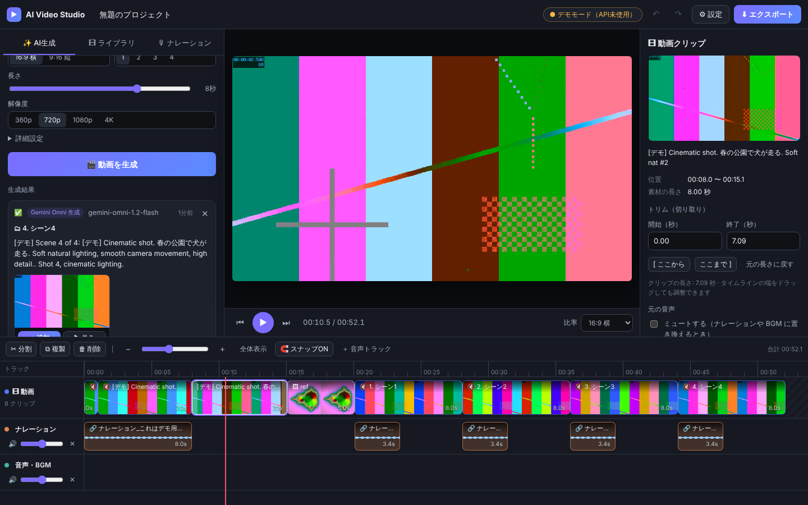

# AI Video Studio

Gemini API（**Gemini Omni** / **Veo**）で動画を生成し、そのまま並べて編集・ナレーション付け・書き出しまでできる、ローカルで動く動画制作ツールです。
自分の API キーで動くので、アプリ側の回数制限はありません（料金とレート制限は Gemini API の契約に従います）。



## はじめかた（いちばん簡単な方法）

このツールは **自分のパソコンの中で動くアプリ** です。Web サイトではないので、URL を開くだけでは使えません。
パソコン（Windows / Mac）にダウンロードして起動してください（スマホ・タブレットでは動きません）。

1. **Node.js を入れる（初回だけ）**
   https://nodejs.org/ja/download を開き、「**LTS**」版をダウンロードしてインストールします（全部「次へ」で OK）。
2. **このツールをダウンロードして展開する**
   ZIP ファイルをダウンロードし、Windows は右クリック →「すべて展開」、Mac はダブルクリックで展開します。
   （GitHub から取る場合: ブランチを選んで「Code」→「Download ZIP」。展開したフォルダの中の `video-studio` を開きます）
3. **起動ファイルをダブルクリックする**
   - **Windows**: `start-windows.bat`
     「Windows によって PC が保護されました」と出たら「詳細情報」→「実行」
   - **Mac**: 「ターミナル」から起動するのがおすすめです（セキュリティ設定を変える必要がありません）
     1. ⌘+スペースで「ターミナル」と入力して開く
     2. `cd ` と入力（cd のあとに半角スペース）→ 展開したフォルダをターミナルの画面にドラッグ＆ドロップ → Enter
     3. `npm install` と入力して Enter（初回だけ。数分かかります）
     4. `npm start` と入力して Enter → ブラウザが開きます。終了はターミナルで Control+C か、ウィンドウを閉じる
     （`start-mac.command` をダブルクリックしても同じことができますが、Apple の公証を受けていないため警告が出ます）
   - 初回は部品のダウンロードで数分かかります。終わると **ブラウザで画面が自動で開きます**（開かなければ http://localhost:8787 を開く）
   - 黒い画面（ターミナル）は使っている間は閉じないでください。閉じるとアプリが終了します

画面が開いたら、右上の「⚙ 設定」に Gemini API キーを入れれば使えます。
キーがまだ無くても、設定で「デモモード」にチェックを入れれば、料金なしで操作を試せます。

2 回目からは、手順 3 のファイルをダブルクリックするだけです。

## できること

| 分類 | 機能 |
|---|---|
| **AI 動画生成** | Gemini Omni（Interactions API）と Veo（predictLongRunning）をモデル一覧から切り替え。一覧は API から自動取得し、一覧にない ID も直接入力できる |
| | 画像・動画・音声・テキスト・PDF・Word・PowerPoint を添付。モデルに直接渡せるものは直接、渡せないものは AI が読み取ってプロンプトに反映 |
| | 画像ごとに役割を指定：参照（人物・物・スタイル）／最初のフレーム／最後のフレーム |
| | 「✨ AIでプロンプト作成」：指示と資料から動画用プロンプトを作成 |
| | 「🗂 ストーリーボード」：資料から複数シーンの構成とナレーション原稿を作り、一括生成してタイムラインに並べる |
| | 生成結果の「✎ 修正」（Omni：前の生成の続きとして指示で直す）と「⇥ 延長」 |
| | 1〜4 本の同時生成、縦横比、長さ、解像度（〜4K）、ネガティブプロンプト、シード、追加パラメータ(JSON) |
| | 1 回で作れる長さはモデルの上限まで選べる：Gemini Omni 1.2 Flash は 3〜15 秒（最初/最後のフレーム指定時は 10 秒まで）、Omni 1.1 / preview は 3〜10 秒、Veo 3.1 は 4・6・8 秒。それ以上は「⇥ 延長」で続きを作る |
| **プレビュー** | 生成結果はカードのホバーで再生でき、クリックで大きく表示。「＋ 追加」でタイムラインの末尾に入る |
| **編集** | 動画を並べる（ドラッグで並べ替え）、両端ドラッグや数値入力でトリム、再生ヘッド位置での分割、複製、削除、元に戻す/やり直す |
| | 音声トラックを追加して BGM・効果音を重ねる（位置・トリム・音量・フェード、スナップ） |
| | 元の音声のミュート・音量（0〜200%）、映像のフェードイン/アウト、画像を静止画クリップとして使う |
| **ナレーション** | Gemini が映像を見て、クリップ（またはタイムライン全体）の長さに収まる原稿を作成 |
| | Gemini TTS（モデル・30 種類のボイス・話し方を指定）で音声化し、長さがずれたら原稿を自動で書き直し、読み上げ速度を微調整して動画の長さにぴったり合わせる |
| | ナレーションはクリップに連動する（クリップを並べ替えても一緒に動く）。元の音声は自動でミュート |
| **書き出し** | MP4（H.264/AAC）・MOV・WebM（VP9/Opus）・GIF。480p〜4K、24/30/60fps、画質 3 段階。16:9 / 9:16 / 1:1 / 4:5 |

## 必要なもの

- **Node.js 20.12 以上**（22 以降を推奨）
- **Gemini API キー**：[Google AI Studio](https://aistudio.google.com/apikey) で取得。Veo / Gemini Omni の動画生成は**有料プラン（課金の有効化）**が必要です
- ffmpeg：`npm install` で同梱版（ffmpeg-static）が自動で入ります。入らない環境ではシステムの ffmpeg を使います

## 使い方（ターミナルから起動する場合）

```bash
cd video-studio
npm install
npm start
```

ブラウザで http://localhost:8787 を開き、右上の「⚙ 設定」に API キーを入力します（`.env` に `GEMINI_API_KEY=...` と書いても OK）。

API を使わずに画面だけ試すには、**デモモード**で起動します（テスト用の映像と音で全機能が動き、料金はかかりません）。

```bash
npm run demo
```

### 基本の流れ

1. **AI生成** タブでモデルを選び、プロンプトを書く（必要ならファイルを添付）→「🎬 動画を生成」
2. 生成結果をプレビューし、気に入ったものを「＋ 追加」でタイムラインへ
3. タイムラインで並べ替え・トリム・分割。BGM は **ライブラリ** タブから読み込んで音声トラックへドラッグ
4. 動画の音が気に入らなければ、クリップを選んで「🎙 このクリップにナレーションを付ける」→「✨ AIで原稿を作成」→「🎙 ナレーションを生成して追加」
5. 右上の「⬇ エクスポート」で MP4 などに書き出し

### 添付ファイルの扱い

| 添付 | Gemini Omni | Veo 3.1 |
|---|---|---|
| 画像 | 既定で**最大 10 枚**を直接入力（役割とメモをテキストで添えて送る） | 最初のフレーム 1・最後のフレーム 1、または参照画像 最大 3 |
| 動画 | 最大 3 本を直接入力（編集・延長の元／参考動画。10 秒以内が目安） | 任意の動画は不可（Veo で生成した動画の「延長」のみ） |
| テキスト / Word / PowerPoint | テキストを抽出して直接入力 | AI が読み取ってプロンプトに反映 |
| PDF / 音声 | AI が読み取ってプロンプトに反映 | 同左 |

上限を超えた画像は、自動的に「AI が読み取ってプロンプトに反映」側に回るので、6 枚以上の資料を付けても無駄になりません。
上限値は API の仕様変更に合わせて「⚙ 設定」で変えられます。

## API について（重要）

- **Gemini Omni** は `POST /v1beta/interactions`（Interactions API）、**Veo** は SDK の `generateVideos`（`predictLongRunning`）で呼び出しています。
- Omni へのリクエストは `response_format: { type: "video", aspect_ratio, duration, resolution, delivery }` を使います。プレビュー版 API のため、もしパラメータが受け付けられなかった場合は自動で省略して再試行し、生成結果に「⚠ 省略しました」と表示します。
- Gemini API の Veo 3.1 preview について、Omni への移行を案内するエラーを返すという報告があります。モデル一覧は API キーから自動取得するので、そのキーで使えるモデルだけが表示されます（取得できない場合は既定の候補を表示）。
- 詳細設定の「追加パラメータ(JSON)」に書いた内容は、そのままリクエストに追加されます（新しいパラメータを試したいとき用）。
- 生成・TTS・原稿作成には API の利用料金がかかります。ストーリーボードの「すべて生成」は確認ダイアログを出します。

## データの保存場所

すべて `video-studio/data/` に保存されます（Git には含まれません）。

| パス | 内容 |
|---|---|
| `data/media/` | 生成動画・読み込んだ素材・ナレーション音声とサムネイル |
| `data/exports/` | 書き出したファイル |
| `data/project.json` | 編集中のプロジェクト（自動保存） |
| `data/settings.json` | 設定（API キーを含む） |

サーバーは既定で `127.0.0.1` のみで待ち受けます（API キーを守るため）。LAN の別端末から使う場合だけ `.env` で `HOST=0.0.0.0` にしてください。

## 困ったとき

| 症状 | 対処 |
|---|---|
| 「APIキーにこのモデルの利用権限がありません」 | AI Studio で課金を有効にする／モデルが提供地域・プランで使えるか確認 |
| 「モデルが見つかりません」 | 「↻」でモデル一覧を更新。モデル ID が変わっていることがあります |
| 動画が返されない | 安全フィルタで止められた可能性があります。人物・ブランド・暴力的表現などを言い換えてください |
| ffmpeg が見つからない | `npm install` をやり直すか、ffmpeg をインストールして `.env` の `FFMPEG_PATH` / `FFPROBE_PATH` を指定 |

## 開発

```bash
npm test   # 書き出し（ffmpeg）と添付ルールのテスト
```

```
server/
  index.js        API ルート
  videogen.js     動画生成（Veo / Gemini Omni）
  assist.js       プロンプト作成・ストーリーボード・資料の読み取り
  narration.js    ナレーション原稿・TTS・長さ合わせ
  export.js       タイムライン → ffmpeg 書き出し
  gemini.js       Gemini API 共通（モデル一覧・Files API・ダウンロード）
  media.js / attachments.js / jobs.js / mock.js / ffmpeg.js / config.js
public/
  index.html, css/app.css
  js/main.js, player.js, timeline.js, inspector.js, dialogs.js, store.js
  js/panels/generate.js, library.js, narration.js
  js/shared/timeline-core.js, capabilities.js   （ブラウザとサーバーで共有）
```
